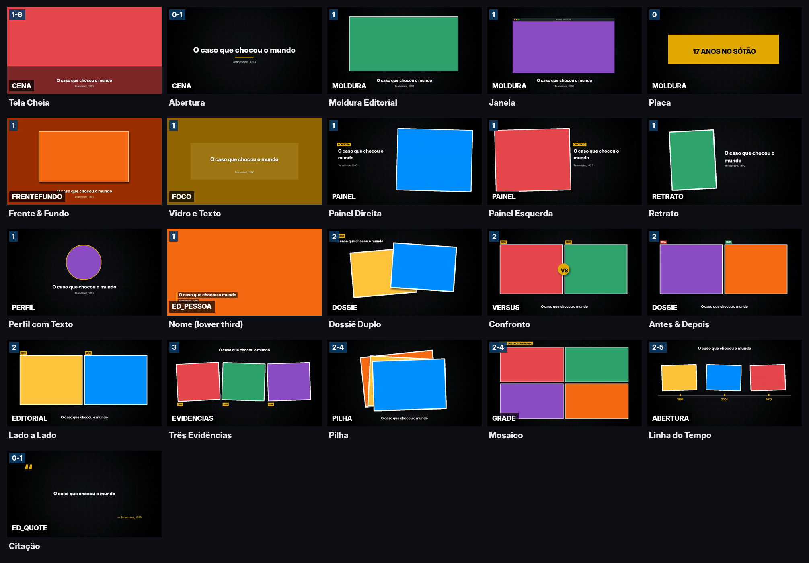

# Fábrica de Vídeos — editor por linha de comando (ffmpeg)

Editor de vídeo baseado em **modelos de cena** e **predefinições com eixos**, no estilo de editor
"Templates / Transições / Movimento / Filtros / Legenda / Marca". Tudo roda com Python 3 (sem
bibliotecas extras) + ffmpeg.



## Requisitos
- Python 3.9+
- ffmpeg 6+ (com `drawtext`/libfreetype, que vem nas builds comuns)

## Comandos

```bash
python3 fabrica.py modelos                       # lista modelos, transições, movimentos e filtros
python3 fabrica.py catalogo -o catalogo.png      # folha de miniaturas dos modelos (como a grade do editor)
python3 fabrica.py demo [--preview]              # gera mídias de teste e renderiza exemplos/demo.mp4

# fluxo da fábrica
python3 fabrica.py auto meu-roteiro.json -p predefinicoes/documentario-classico.json   # -> meu-roteiro.projeto.json
python3 fabrica.py render meu-roteiro.projeto.json --preview   # rascunho em meia resolução
python3 fabrica.py render meu-roteiro.projeto.json             # final 1080p
python3 fabrica.py render meu-roteiro.projeto.json --cena 4    # só a cena 4
```

As cenas são renderizadas em paralelo e ficam em cache (`.render_cache/`). Ao mudar uma cena, só ela é
refeita; o resto é reaproveitado.

## Como funciona

```
roteiro.json  ──┐
                ├─ auto ─▶ projeto.json ─ render ─▶ cena_001.mp4 … cena_N.mp4 ─ xfade/acrossfade ─▶ video.mp4
predefinição ───┘                                     (filter_complex por modelo)          (+ trilha com ducking)
```

### 1. Roteiro (o que o vídeo fala)
Um bloco por trecho de narração. Os campos são opcionais, exceto o que o modelo precisar.

```json
{
  "formato": "16:9",
  "avatar": "dreamface/apresentador.mp4",
  "blocos": [
    { "narracao": "audio/01.mp3", "texto_narracao": "Em janeiro de 1995...",
      "midias": ["fotos/campus.jpg"], "texto": "Tennessee, 1995" },
    { "narracao": "audio/02.mp3", "midias": ["fotos/a.jpg", "fotos/b.jpg"],
      "rotulos": ["a acusada", "a vítima"], "destaque": "1995" },
    { "modelo": "placa", "narracao": "audio/03.mp3", "texto": "E SE FOSSE NO BRASIL?" }
  ]
}
```

| Campo | Para quê |
|---|---|
| `narracao` | áudio do bloco. A duração "Auto" da cena vem dele |
| `texto_narracao` | vira legenda automática (se o eixo Legenda estiver ativo) |
| `midias` | fotos/vídeos. A quantidade decide quais modelos servem (1, 2, 3, 4…) |
| `texto`, `subtexto`, `rotulos`, `etiqueta` | textos usados pelo modelo (título, datas, selos) |
| `destaque` | palavra ou frase que "estoura" no meio da cena (eixo Destaques) |
| `avatar` | vídeo do apresentador (ex.: DreamFace) em círculo no canto (eixo Avatar) |
| `modelo`, `transicao`, `movimento`, `filtro` | força uma escolha e ignora o sorteio |

### 2. Predefinição (como o vídeo fica)
Igual aos eixos do editor: cada eixo tem `pct` (quantas cenas recebem o eixo; o resto fica limpo)
e `modo` = `todos` ou `escolher` (+ `lista`).

```json
{
  "eixos": {
    "templates":  { "pct": 70, "modo": "todos", "excluir": ["janela"] },
    "avatar":     { "pct": 20 },
    "destaques":  { "pct": 60 },
    "transicoes": { "pct": 50, "modo": "escolher", "lista": ["shutter", "whoosh", "fade", "flash", "zoom"] },
    "movimento":  { "pct": 75, "modo": "escolher", "lista": ["zoom_in", "zoom_out", "pan_esquerda", "pan_direita"] },
    "filtros":    { "pct": 40, "modo": "escolher", "lista": ["cinema", "pb"] },
    "legenda":    { "ativo": true, "estilo": "rodape" }
  },
  "cor": "#E2A900",
  "marca":  { "logo": "logo.png", "posicao": "sup-dir", "opacidade": 0.7 },
  "trilha": { "arquivo": "trilha.mp3", "volume": 0.12, "abaixar_na_fala": true }
}
```

- **Templates:** cenas fora do % viram `tela_cheia` (limpa). O sorteio só usa modelos que aceitam a
  quantidade de mídias do bloco e evita repetir o mesmo modelo seguido.
- **Transições** (`shutter`, `whoosh`, `zoom`…) tocam um *whoosh* sintetizado automaticamente.
- **Trilha:** em loop até o fim, com fade-out e *ducking* (abaixa quando a narração fala).
- `semente` muda o sorteio. A mesma semente sempre gera o mesmo projeto.

### 3. Projeto (a linha do tempo final)
O `auto` gera o projeto, mas você pode escrever ou editar à mão:

```json
{ "formato": "16:9", "fps": 30, "cor": "#E2A900",
  "cenas": [
    { "modelo": "dossie", "midias": ["a.jpg", "b.jpg"], "narracao": "02.mp3", "duracao": "auto",
      "transicao": "shutter", "movimento": "zoom_in", "filtro": "cinema", "destaque": "1995",
      "legenda": { "texto": "As duas se conheciam...", "estilo": "rodape" } }
  ] }
```

`formato`: `16:9`, `9:16` (Shorts/Reels), `1:1`, `4:5`.

## Catálogo atual

| Selo | Modelos |
|---|---|
| CENA | `tela_cheia` (1–6, vira sequência), `abertura` (0–1) |
| MOLDURA | `moldura`, `janela`, `placa` (0) |
| FRENTEFUNDO / FOCO | `frente_fundo`, `foco` |
| PAINEL / RETRATO / PERFIL / ED_PESSOA | `painel_direita`, `painel_esquerda`, `retrato`, `perfil`, `nome` |
| DOSSIE / VERSUS / EDITORIAL | `dossie` (2), `confronto` (2), `antes_depois` (2), `lado_a_lado` (2) |
| EVIDENCIAS / PILHA / GRADE | `evidencias` (3), `pilha` (2–4), `grade` (2–4) |
| ABERTURA / ED_QUOTE | `linha_do_tempo` (2–5), `citacao` (0–1) |

Transições: `corte fade preto flash shutter persiana whoosh empurrar zoom desfoque cortina circulo vento pixel`
Movimentos: `zoom_in zoom_out pan_esquerda pan_direita pan_cima`
Filtros: `cinema pb arquivo granulado frio quente`

## Criar um modelo novo
Em `motor/modelos.py`:

```python
@modelo("meu_modelo", "DOSSIE", "Meu Modelo", (2, 2), 5.0, "descrição")
def meu_modelo(c, cena):
    base = c.fundo()
    card = c.cartao(0, c.W * 0.4, c.H * 0.5, borda=10, rot=-4)        # mídia 1 com moldura e sombra
    base = c.colocar(base, card, c.W * 0.35, c.H / 2, atraso=0.1)     # entra de baixo com easing
    card = c.cartao(1, c.W * 0.4, c.H * 0.5, rot=3)
    base = c.colocar(base, card, c.W * 0.65, c.H / 2, atraso=0.5, entrada="direita")
    return c.etiqueta(base, cena.get("etiqueta", "dossiê"), 80, 60)
```

Ferramentas da caneta `c`: `fundo`, `fundo_midia`, `midia`, `cartao`, `circulo_midia`, `bloco`,
`circulo`, `sombra`, `colocar`, `texto`, `etiqueta`.

## Ligando com a fábrica (Notion)
Cada tarefa do Notion vira um roteiro: os blocos do roteiro (gancho, vítimas, virada, investigação,
revelação, sentença, "E se fosse no Brasil?") viram `blocos`, o áudio do TTS/DreamFace vira `narracao`/`avatar`,
e as imagens geradas viram `midias`. Rode `auto` + `render` e o vídeo sai pronto para revisão.

## Limitações
- A legenda automática divide o texto em partes iguais ao longo da narração (não há tempo palavra a
  palavra). Para sincronia exata, gere `.srt` com Whisper e passe cada trecho como bloco.
- `zoompan` e sombras desfocadas são pesados: em 1080p conte ~2–3× o tempo do vídeo (CPU de 4 núcleos).
  Use `--preview` para revisar.
- Debug: `FABRICA_DEBUG=1` salva o filter_complex de cada cena ao lado do MP4 do cache.
