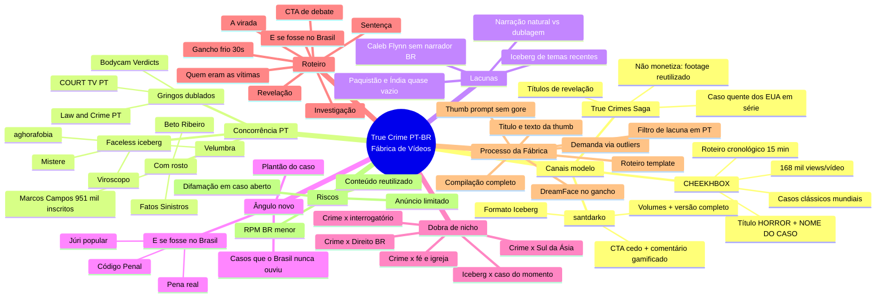

# Pesquisa de Demanda — True Crime / Mistérios → PT-BR

> Fábrica de Vídeos · pesquisa feita em 21/10/2026 com dados do NexLev (YouTube) + leitura das transcrições dos vídeos top de cada canal modelo.
> Observação: o comando `/demanda-youtube` não existe nesta sessão (não há skill com esse nome instalada), então reproduzi as etapas manualmente: dados do canal → outliers → estrutura de roteiro → busca de concorrentes em PT-BR → lacunas → ângulo.

---

## 0. Resumo executivo (o que fazer)

1. **Os 3 canais são o mesmo macro-nicho (True Crime faceless de 15–60 min), com 3 ângulos diferentes:**
   - **CHEEKHBOX** → casos clássicos *mundiais* chocantes, recontados em ordem cronológica, título em CAIXA ALTA com o "horror" na frente e o nome do caso atrás.
   - **santdarko** → formato **ICEBERG** (lista em camadas, da superfície às profundezas), séries com volumes e versões "[completo]". Já é brasileiro.
   - **True Crimes Saga** → **"plantão" de casos em andamento nos EUA** (execução de Christa Pike, julgamento de Caleb Flynn), títulos de revelação ("SECRETS Revealed", "What he REALLY did").
2. **Em PT-BR o true crime está cheio, mas tem 3 buracos claros:**
   - **Casos atuais dos EUA narrados por brasileiro nativo**: o caso Caleb Flynn em português só tem canais gringos dublados automaticamente (COURT TV, Bodycam Verdicts, Crimes Revealed). Christa Pike provou a demanda: Domingo Espetacular 952 mil, Beto Ribeiro 727 mil, Marcos Campos 571 mil views.
   - **Casos do Paquistão / Índia / Sul da Ásia** (a praia do CHEEKHBOX): a busca em PT devolve quase só noticiário indiano dublado. Um único caso desse tipo em PT ("Saima Khan", The Real Files) fez **380 mil views**.
   - **Iceberg de casos *recentes* e de temas específicos** (execuções que deram errado, pastores criminosos, gêmeos sinistros): os icebergs BR são quase todos de "mistérios gerais" ou "crimes brasileiros".
3. **Ângulo novo recomendado (dobra de nicho):** **"True crime gringo explicado pela lei brasileira"**. Cada caso termina com o bloco *"E se fosse no Brasil?"* (pena, júri, prescrição, como a polícia brasileira agiria). Ninguém faz isso de forma fixa, dá identidade à narração em português e não depende de rosto.
4. **Mix de pauta sugerido para a fábrica:** 60% caso clássico internacional (evergreen, modelo CHEEKHBOX) · 25% caso em andamento (modelo True Crimes Saga, sobe rápido) · 15% iceberg temático (modelo santdarko, alimenta as compilações "[completo]").

---

## 1. Raio-X dos 3 canais modelo

### 1.1 CHEEKHBOX — o canal do vídeo enviado
| Item | Dado |
|---|---|
| Link | youtube.com/@cheekhbox (vídeo enviado: `91tcWxCvyQQ`, "THE TWIN SISTERS THAT SHOCKED THE WORLD…", 34 mil views em 5 dias) |
| País / idioma | Paquistão · narração em Hindi/Urdu com faixa em inglês (a transcrição puxada veio em inglês) |
| Criado | 29/06/2026 (menos de 4 meses) |
| Tamanho | 8,35 mil inscritos · 13 vídeos · 2,19 milhões de views |
| Média | **~168 mil views/vídeo** · duração média 15,6 min · RPM estimado US$ 2,32 · monetizado · faceless |

**Top vídeos (outliers):**
| Views | Título | Duração |
|---|---|---|
| 869 mil | THEY SUFFERED A NIGHT WORST THAN HELL \| THE CHANNON-NEWSOM CASE | 15:20 |
| 379 mil | THE BROTHERS WHO EAT DEAD BODIES FROM GRAVES \| THE MOST SHOCKING CASE IN PAKISTAN'S HISTORY | 8:06 |
| 247 mil | THE WORST PARENTS EVER EXISTED ON EARTH \| THE FRED & ROSE WEST CASE | 26:05 |
| 244 mil | HE MADE HER GIVE BIRTH TO 7 BABIES \| SHE WAS LOCKED IN BASEMENT FOR 24 YEARS (Fritzl) | 9:01 |
| 118 mil | SHE WAS SLEEPING WHEN 72 MEN USED HER… (Pelicot) | 10:21 |
| 110 mil | ALL FAMILY MEMBERS WENT MISSING ONE BY ONE \| THE ANDRÁS & ÁGNES PÁNDY CASE | 22:40 |
| 94 mil | THE MOST UNLUCKY SINGH FAMILY IN THE WORLD \| THE SPA BATH CASE | 25:40 |

**Ângulo do canal:** pega casos **já famosos no mundo** (Fritzl, Fred & Rose West, Junko Furuta, Albert Fish, Armin Meiwes) e traz para um público que ainda não os consumiu no próprio idioma. O ganho não vem da pauta, vem da **embalagem** (título de choque) e do **idioma**.

**Fórmula de título:** `[O HORROR EM UMA FRASE, SEM NOME] | THE [NOME] CASE` → o nome do caso fica no fim, para quem pesquisa; a frase de choque fica no começo, para quem só vê o título na home.

**Estrutura de roteiro (Channon-Newsom, ~2.400 palavras / 15 min):**
1. **Gancho em 2 frases** com o resultado final ("os corpos foram encontrados…") + pergunta ("por que isso aconteceu e quem fez?").
2. Promessa: "No documentário de hoje vamos analisar em detalhes…".
3. **Biografia das vítimas** em ordem cronológica (nascimento, escola, sonhos), para criar empatia.
4. "E então veio a noite que provou que os dois estavam errados" (virada).
5. A noite do crime → a busca → a investigação (torres de celular, pistas).
6. Prisões → julgamentos → sentenças (uma por réu).
7. Legado (fundações, homenagens).
8. **CTA de opinião**: "O que você acha? Comente."

---

### 1.2 santdarko — já é brasileiro
| Item | Dado |
|---|---|
| Link | youtube.com/@santdarko |
| País / idioma | Brasil · PT-BR (títulos traduzidos para inglês via recurso de múltiplos idiomas) |
| Criado | 08/07/2026 |
| Tamanho | 2,27 mil inscritos · 9 vídeos · 334 mil views |
| Média | **~37 mil views/vídeo** · duração média 33,5 min · RPM estimado US$ 6,79 · monetizado · faceless |

**Vídeos:**
| Views | Título | Duração |
|---|---|---|
| 128 mil | O Iceberg Definitivo de Enigmas Não Solucionados (vídeo de estreia) | 32:08 |
| 64 mil | O Iceberg de Desaparecimentos Obscuros sem Solução **[completo]** | 58:38 |
| 38 mil | O Iceberg de Crimes Bizarros Brasileiros **[completo]** | 52:36 |
| 32 mil | …Desaparecimentos Obscuros sem Solução [vol.2] | 27:34 |
| 31 mil | O Iceberg de Desaparecimentos Criminosos sem Solução | 31:58 |
| 21 mil | O Iceberg de Crimes Bizarros Brasileiros | 21:05 |
| 12 mil | …Crimes Bizarros Brasileiros [vol.2] | 32:18 |
| 7,9 mil | Desaparecimentos Obscuros sem Solução [vol.3] (4 dias) | 21:53 |
| 2,8 mil | The Espionage & Secret Operations Iceberg | 23:33 |

**Ângulo do canal:** formato **iceberg** (camadas do mais conhecido ao mais obscuro) aplicado a enigmas, desaparecimentos e crimes brasileiros. Estratégia de **série com volumes** e depois **"[completo]"** = junta os volumes num vídeo longo (o "[completo]" sempre supera os volumes isolados → reaproveitamento barato, perfeito para fábrica).

**Fórmula de título:** `O Iceberg de [Tema] [Adjetivo Sombrio] [sem Solução] [vol.X | completo]`.

**Estrutura de roteiro (Enigmas, ~4.660 palavras / 32 min ≈ 145 palavras/min):**
1. Gancho de 20 s ("existem textos… que a ciência não consegue decifrar até hoje").
2. Convite pessoal ("quero que você venha comigo explorar o iceberg… da parte mais popular até as profundezas").
3. **CTA cedo**: like + inscrição antes do primeiro item.
4. Item a item (1–3 min cada): contexto → o mistério → teorias → "até hoje ninguém sabe".
5. Fechamento recapitulando a jornada + frase-assinatura ("os mistérios sempre serão infinitos").
6. **CTA de comentário gamificado**: "comente qual o próximo iceberg… se não tiver o que comentar, comente *enigma* de trás pra frente".

---

### 1.3 True Crimes Saga
| Item | Dado |
|---|---|
| Link | youtube.com/@Truecrimessaga |
| País / idioma | Nigéria · inglês |
| Criado | 26/08/2025 (vídeos atuais todos de outubro/2026) |
| Tamanho | 719 inscritos · 9 vídeos · 176 mil views |
| Média | ~19,6 mil views/vídeo · 30 min · RPM estimado US$ 7,33 · **NÃO monetizado** · faceless |

**Vídeos:**
| Views | Título |
|---|---|
| 68 mil | Inside the Room: SECRETS Revealed About Christa Pike's NEXT EXECUTION |
| 50 mil | "Where Is The Gun?!" What Caleb Flynn REALLY Did Before Calling 911 |
| 26 mil | WHY Caleb Flynn's Lawyers DUMPED Him Immediately After filing Appeals! |
| 17 mil | Why The 911 Operator REFUSED To Help Christa Pike For 30 Minutes |
| 10 mil | They Failed to Execute Her. Now Christa Pike Could Walk Free |
| 4,8 mil | What Christa Pike's Boyfriend, Tadaryl Shipp, Never Revealed Until Now |

**Ângulo do canal:** **acompanhar 1–2 casos quentes dos EUA, vídeo após vídeo**, cada vídeo com um "detalhe novo" (o 911, o advogado, o namorado, o recurso). É o modelo "novela do caso": quem viu um quer o próximo.

**Fórmula de título:** `[Citação ou revelação] + O que [pessoa] REALMENTE fez / POR QUE [alguém] RECUSOU…` com 1–2 palavras em CAIXA ALTA.

**Estrutura de roteiro:** abre **direto em áudio de testemunha/imprensa/interrogatório**, narrador faz pontes curtas e fecha com CTA ("se quer a verdade por trás das manchetes, não pare aqui… o próximo caso pode ser o que todo mundo está comentando").
⚠️ **Por que não monetiza:** o vídeo é quase todo **filmagem de terceiros (TV, Court TV, bodycam) costurada** = "conteúdo reutilizado". **Copiar o ângulo, NÃO o método.** Na fábrica: narração 100% própria, imagens próprias/IA, e trechos de terceiros só curtos e comentados.

---

## 2. Concorrência em PT-BR

### 2.1 Canais brasileiros relevantes (métricas NexLev)
| Canal | Formato | Rosto? | Média views/vídeo | Duração média | RPM est. | Observação |
|---|---|---|---|---|---|---|
| **Marcos Campos** (951 mil inscritos) | caso único, documental | sim | 210 mil | 33 min | US$ 5,11 | Christa Pike 571 mil · Clodimar Pedrosa Lô 719 mil (11 dias) |
| **Beto Ribeiro** (jornalista) | caso comentado | sim | 208 mil | 40 min | US$ 4,04 | Christa Pike 727 mil |
| **Fatos Sinistros – Mirla Prado** | stories | sim | 334 mil | 32 min | US$ 4,44 | caso italiano fez 59 mil em 20 h |
| **Viroscopo** (71,8 mil inscritos, 8,7 mi views) | **iceberg gigante** (2–3,5 h) | não | 96 mil | 85 min | US$ 2,12 | Serial Killers BR 327 mil · Casos Criminais BR IV 140 mil · V 92 mil |
| **Mistere** | iceberg mistérios BR | não | 162 mil | 40 min | US$ 5,77 | Mistérios do Brasil #1 181 mil |
| **aghorafobia** | iceberg / desaparecimentos | não | 114 mil | 24 min | US$ 6,56 | 108 mil e 115 mil nos icebergs |
| **Velumbra** | iceberg (mar, Bíblia, sobrenatural) | – | 168 mil | 56 min | US$ 9,70 | Casos do Mar 288 mil |
| **Investigação Criminal** (Carla Albuquerque) | documentário + entrevistas | não | 68 mil | 31 min | US$ 5,54 | "pioneiros do true crime BR" |
| **Doc Doc Criminal** | casos BR regionais | não | 50 mil | 41 min | US$ 6,04 | – |
| **Canal Vilão** | notícia/caso do momento | sim | 29 mil | 15 min | US$ 3,22 | 2 vídeos de Christa Pike |
| Semydeus | iceberg | – | – | – | – | 376 mil (vídeo de 2 anos) |

### 2.2 Concorrentes "gringos dublados" (o inimigo invisível)
A busca em português está cheia de canais estrangeiros com **áudio dublado automático para PT**: COURT TV em Português, Bodycam Verdicts, Law&Crime em Português, Damon Verial em Português, Real Detectives, Documentary Vault, LAST SEEN ALIVE, ECOS DEL MISTERIO (este fez 111 mil em 7 dias com "Matou a própria mãe…").
→ **Implicação:** narração robótica/dublada é o padrão do mercado gringo em PT. **Narração natural em PT-BR + referências brasileiras é o diferencial que eles não conseguem copiar.**

### 2.3 Prova de demanda por ângulo
| Ângulo do canal modelo | Prova em PT | Saturação | Leitura |
|---|---|---|---|
| Caso em andamento EUA (True Crimes Saga) | Christa Pike: 952 mil (Domingo Espetacular), 727 mil (Beto Ribeiro), 571 mil (Marcos Campos) | **média**: TV + 2 grandes, o resto é dublagem | Caleb Flynn em PT só tem dublados (Mental Healness 25 mil, Crimes Revealed 11 mil) → **janela aberta** |
| Caso clássico mundial chocante (CHEEKHBOX) | ECOS DEL MISTERIO 111 mil/7 dias; Saima Khan (The Real Files) 380 mil | **alta** para casos ocidentais famosos; **baixíssima** para Paquistão/Índia | Pegar os casos asiáticos do CHEEKHBOX e os ocidentais pouco contados em PT |
| Iceberg (santdarko) | Viroscopo 327 mil, Semydeus 376 mil, Velumbra 288 mil, Mistere 181 mil | **alta** em "mistérios gerais"; baixa em icebergs **de temas recentes ou específicos** | Iceberg temático + versão "[completo]" |
| Interrogatório / júri (bônus) | O TRIBUNAL DO JÚRI 350 mil; Fala Tribunos 34 mil | média | Serve como **bloco** dentro do vídeo (análise de interrogatório), não como canal |

---

## 3. Ângulo novo (o que ninguém faz em PT)

### Ângulo principal: **"True crime gringo com a lente da lei brasileira"**
Cada vídeo segue o modelo CHEEKHBOX (caso contado do zero) e termina com um bloco fixo de 2–3 min: **"E SE FOSSE NO BRASIL?"**
- Qual crime seria pelo Código Penal (feminicídio, latrocínio, ocultação de cadáver…)?
- Pena provável, progressão de regime, "quanto tempo ficaria preso de verdade".
- Iria a júri popular? Teria pena de morte? (não — e por quê).
- Comparar com um caso brasileiro parecido (ex.: Caleb Flynn ↔ casos de feminicídio no Brasil; Fritzl ↔ casos de cárcere privado no Brasil).

**Por que funciona:** gera debate nos comentários (o brasileiro adora discutir pena), cria identidade e assinatura de canal, é 100% conteúdo original (afasta "conteúdo reutilizado") e é impossível de copiar com dublagem automática.

### Ângulos secundários (para testar)
1. **"Plantão do caso"** (modelo True Crimes Saga): escolher 1 caso quente dos EUA por mês e fazer série de 3–5 vídeos, cada um com uma revelação nova (911, interrogatório, amante, recurso, sentença).
2. **"Casos que o Brasil nunca ouviu"** (modelo CHEEKHBOX): Paquistão, Índia, Bangladesh, Coreia, Japão. Ex.: os irmãos de Bhakkar que comiam corpos de cemitério (379 mil no CHEEKHBOX).
3. **Iceberg de tema quente** (modelo santdarko): "Iceberg das execuções que deram errado", "Iceberg dos pastores criminosos", "Iceberg dos gêmeos mais sinistros", "Iceberg dos casos do Paquistão e da Índia".

---

## 4. Dobra de nicho (combinações)

| Dobra | Exemplo de vídeo | Potencial | Esforço na fábrica |
|---|---|---|---|
| **True crime × Direito BR** ⭐ | "Caleb Flynn: quanto tempo ele pegaria no Brasil?" | alto | baixo (bloco fixo no roteiro) |
| **Iceberg × caso do momento** | "O Iceberg do Caso Christa Pike (do crime de 1995 à execução que falhou)" | alto e rápido | médio |
| **True crime × Sul da Ásia** | "Os irmãos que desenterravam mortos no Paquistão" | alto (pouca concorrência) | médio (fontes em inglês) |
| **True crime × psicologia do interrogatório** | "As 7 mentiras de Caleb Flynn no interrogatório" | médio | médio |
| **True crime × fé/igreja** | "Pastores que mataram: o Iceberg" (Velumbra mostra que religião paga RPM alto, est. US$ 9,70) | médio–alto | baixo |
| **Iceberg × regional BR** | "Iceberg dos casos do Nordeste / Goiás / interior paulista" | médio (Viroscopo e Doc Doc já exploram) | baixo |
| **Compilação longa "para maratonar"** | "[completo] 2h de casos do Paquistão e Índia" | médio (watch time) | quase zero (reuso) |

---

## 5. Estilo de roteiro → template da Fábrica

**Duração-alvo:** 22–32 min (≈ 3.200–4.600 palavras a 145 palavras/min). Compilações "[completo]": 50–120 min.

| Bloco | Tempo | O que entra | Veio de |
|---|---|---|---|
| 1. Gancho frio | 0:00–0:30 | o fato mais chocante + a pergunta que o vídeo responde (sem nome do caso ainda) | CHEEKHBOX / True Crimes Saga |
| 2. Promessa + CTA leve | 0:30–1:00 | "hoje você vai entender… e no final eu te conto como seria no Brasil" + like/inscrição | santdarko (CTA cedo) |
| 3. Quem eram (vítimas) | 1–5 min | biografia curta, sonhos, rotina → empatia | CHEEKHBOX |
| 4. A virada | 5–6 min | "e então veio a noite que…" | CHEEKHBOX |
| 5. O crime / a noite | 6–12 min | linha do tempo hora a hora | todos |
| 6. Investigação | 12–18 min | pistas, erros, interrogatório (trechos curtos e comentados) | True Crimes Saga |
| 7. Reviravolta / revelação | 18–21 min | o detalhe que ninguém conta (é ele que vira título) | True Crimes Saga |
| 8. Julgamento e sentença | 21–25 min | réu por réu | CHEEKHBOX |
| 9. **E se fosse no Brasil?** | 25–28 min | bloco fixo de lei brasileira (ângulo novo) | **novo** |
| 10. CTA de debate | 28–29 min | pergunta polêmica + comentário gamificado + frase-assinatura | santdarko |

**Regras de linguagem:** 2ª pessoa ("você"), frases curtas, uma pergunta aberta a cada ~3 min (loop de retenção), "acusado/suposto" para quem não foi condenado, sem descrever violência sexual com detalhes (protege anúncio e respeito à vítima).

---

## 6. Encaixe no processo da sua Fábrica (Notion)

O banco "Gestão de tarefas" do Notion já tem os campos certos: `TITULO ORIGINAL` → `TITULO` → `TEXTO DA THUMB` → status `ROTEIRO/DREAMFACE` → prompt JSON da thumb (o mesmo modelo do Pesca Latina).

| Etapa | Como fazer neste nicho |
|---|---|
| **Demanda** | Rodar outliers do CHEEKHBOX / True Crimes Saga / Hidden Killers (Tony Brueski) / Los Misterios de Lada → copiar em `TITULO ORIGINAL` |
| **Filtro de lacuna** | Buscar o caso no YouTube em PT: se o top em PT tem menos de 100 mil views **ou** só tem dublado → **verde** |
| **Pesquisa** | Fontes públicas (processo, imprensa, documentário oficial). Anotar datas e nomes para a linha do tempo |
| **Roteiro** | Template da seção 5 + bloco "E se fosse no Brasil?" |
| **TITULO (PT)** | Fórmulas da seção 7 |
| **TEXTO DA THUMB** | 2–3 palavras em CAIXA ALTA: "NÃO MORREU", "17 ANOS", "ELE MENTIU" |
| **Thumb (prompt)** | Mesmo esqueleto JSON do Pesca Latina, trocando: cena noturna/fria, sala de interrogatório, fita amarela, foto P&B; **sem sangue, sem corpo, sem arma apontada** (segurança de anúncio) |
| **DREAMFACE** | Usar o avatar só no **gancho e no bloco "E se fosse no Brasil?"** (um "apresentador" fixo dá cara de canal e diferencia dos dublados); o resto faceless |
| **Edição** | Imagens IA de ambientação, mapas, linha do tempo, recortes de documentos; trecho de TV/bodycam só curto e com comentário por cima |
| **Reaproveitamento** | A cada 3 vídeos do mesmo tema → compilação "[completo]" (modelo santdarko) |

---

## 7. Fórmulas de título + backlog inicial

**Fórmulas (adaptadas dos 3 modelos):**
- CHEEKHBOX → `[HORROR EM UMA FRASE] | O CASO [NOME]`
- True Crimes Saga → `O que [NOME] REALMENTE fez antes de [ação]` · `POR QUE [alguém] [atitude chocante]`
- santdarko → `O Iceberg de [Tema] [Adjetivo] [vol.X | completo]`
- Novo → `[NOME]: quanto tempo ele pegaria no BRASIL?`

**Backlog de 15 pautas:**
1. ELA SOBREVIVEU À PRÓPRIA EXECUÇÃO | O CASO CHRISTA PIKE (e se fosse no Brasil?)
2. O que CALEB FLYNN realmente fez antes de ligar para o 911
3. O pastor que fingiu um assalto: quanto tempo Caleb Flynn pegaria no Brasil?
4. OS IRMÃOS QUE DESENTERRAVAM MORTOS | O CASO MAIS CHOCANTE DO PAQUISTÃO
5. AS GÊMEAS QUE FALAVAM UMA LÍNGUA SÓ DELAS | O CASO JUNE E JENNIFER GIBBONS
6. A FAMÍLIA SUMIU UM POR UM | O CASO PÁNDY (Hungria)
7. 24 ANOS NUM PORÃO | O CASO FRITZL e o caso brasileiro parecido
8. A NOITE MAIS LONGA DO TENNESSEE | O CASO CHANNON CHRISTIAN E CHRISTOPHER NEWSOM
9. O Iceberg das Execuções que Deram Errado
10. O Iceberg dos Pastores Criminosos
11. O Iceberg dos Gêmeos Mais Sinistros da História
12. O Iceberg dos Casos Criminais do Paquistão e da Índia
13. Sandra Birchmore: o que se sabe do caso e o que ainda não fecha
14. AS 7 MENTIRAS DO INTERROGATÓRIO | Caleb Flynn analisado
15. [completo] 2 horas de casos que o Brasil nunca ouviu

---

## 8. Riscos e cuidados

- **Conteúdo reutilizado:** é o motivo provável de o True Crimes Saga não estar monetizado. Narração e imagens precisam ser próprias.
- **Anúncios limitados (ícone amarelo):** títulos e thumbs com violência sexual explícita (estilo "72 MEN USED HER") derrubam anúncio. Suavizar em PT: "O caso que chocou a França".
- **RPM real em PT:** as estimativas do NexLev (US$ 2–7) são otimistas para público 100% brasileiro, porque esses canais têm parte da audiência fora do Brasil (títulos traduzidos). Planeje com **US$ 1,5–3 de RPM** para audiência BR.
- **Casos em andamento:** usar "acusado", "segundo a promotoria", "a defesa nega". Nunca afirmar culpa antes da sentença.
- **Dignidade das vítimas:** contar quem eram antes do crime (isso também melhora a retenção, como no CHEEKHBOX).

---

## 9. Mapa mental

---

## 10. Método e limitações

- Fontes: NexLev (dados de canal, vídeos, métricas em lote, transcrições, busca do YouTube com região BR/idioma PT) e o Notion do projeto "Pesca Latina" (para entender o processo da fábrica).
- Transcrições lidas: santdarko "Iceberg Definitivo de Enigmas", CHEEKHBOX "Channon-Newsom", True Crimes Saga "Inside the Room… Christa Pike" e "Where Is The Gun?! … Caleb Flynn" (abertura, meio e final de cada uma).
- Views citadas são as que o YouTube mostrou na data da pesquisa. RPM e "monetizado" são **estimativas** do NexLev, não números oficiais.
- Não analisei as thumbnails visualmente; a recomendação de thumb vem do processo que você já usa no Pesca Latina.
